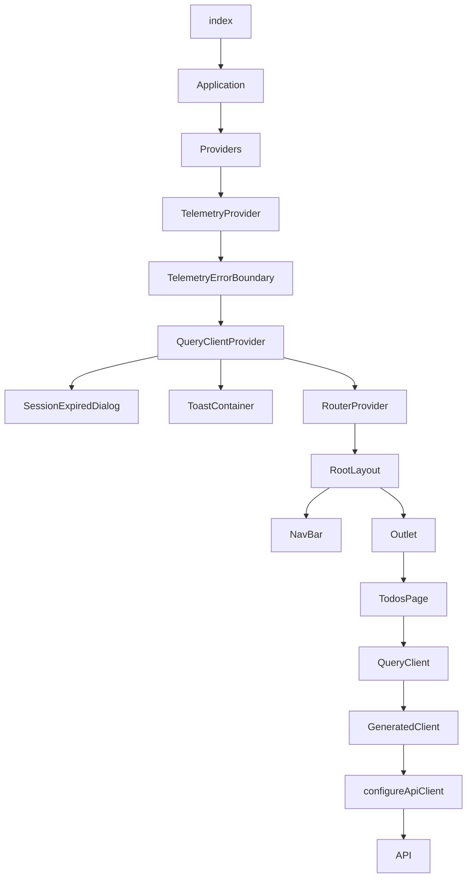

# Extending the web

The web app uses React, TanStack Router/Query, EDS, and the released
[`@team-hermes/react-components`](https://github.com/equinor/team-hermes-packages)
package. Tooling is pnpm + Vite+; run `mise run lint:web`, `mise run test:web`,
and `mise run build:web` from the repository root.

## Codebase structure

```text
web/src/
  api-generated/       Generated OpenAPI client; do not edit
  app/
    bootstrap/         Providers, query-client composition, router defaults
    auth/              Session-expired dialog and reauthentication
    layout/            Hermes NavBar + TanStack Router Link
    routes/            File-based routes and loaders
  config/              Typed environment, flags and role configuration
  features/todos/      Todo UI, schema, query keys, queries and mutations
  shared/
    components/        Template-specific UI
    hermes/            Released-package consumer contracts and gap trackers
    platform/          API/auth/access-control/flags and Hermes public barrels
```

Import features and platform modules through their public barrels. Oxlint prevents
deep imports from outside those modules, and prevents `shared/` from depending on
`features/` or `app/`. Keep these boundaries when adding features.

## Application tree



Authentication is handled by the oauth2-proxy BFF and HttpOnly cookies, not browser
bearer tokens. Keep the local API funnel, reauthentication/session watcher,
access-control and feature flags: Hermes does not replace them.

## Shared components and platform

Import Hermes `ErrorPanel`, `Popover`, `NavBar`, `useCustomToast` and theme helpers
directly from `@team-hermes/react-components`. Use its telemetry
instead of recreating it locally. Import
`@team-hermes/react-components/style.css` and React Toastify's CSS once in
`index.tsx`. Keep one React Toastify container in `Providers`.

The template's Header supplies TanStack Router's Link directly, application
name/repository, user and sign-out callback to `NavBar`. Its support dialog owns
version information; its user popover owns identity and sign-out. The template has
no navigation categories beyond its home link. The BFF user model has no email,
so no email is displayed.

Call `useCustomToast()` in React. Bootstrap passes its callbacks to
`createQueryClient({ telemetry, toast })`, preserving metadata-driven invalidation,
non-retryable 401/403/404 queries, no mutation retries, and 401 toast suppression.
`toast.error` telemetry retains the API trace ID shown by `ErrorPanel`.

Telemetry is created once from `ENV.telemetryBackend`. App Insights loads lazily
and ingests through `/api/monitoring/`. Global error handlers and the session
watcher return cleanup functions used on unmount/HMR. The single telemetry error
boundary remains inside `Providers`.

Zod is configured with `jitless: true` before route/schema imports. Its optional
JIT uses `Function()`, which violates the production CSP even when the probe
catches the error. Keep the startup import first; do not allow `unsafe-eval`.

## Released Hermes 1.11.0 limitations

Consume the released npm package, not local links, patches, or unmerged upstream
changes. Consumer tests retain known gaps with `test.fails` or `test.todo`.

- Theme has a light/dark toggle, follows the OS only while no preference is saved,
  and has no System/auto reset. Storage access can throw.
- App Insights automatic exception collection remains enabled and can duplicate
  global-handler exception reports.
- Support metadata fetches literal `version.txt`, relative to the current route
  rather than the app base. HTTP failure/empty metadata is not normalized to
  `unknown`; missing fields can produce incomplete or invalid commit links.
- ErrorPanel handles circular references and BigInt, but quotes thrown strings.
  If both JSON serialization and string coercion throw, rendering still throws.
- Toasts use Hermes content and React Toastify dismissal/progress. Success lasts
  3 seconds, errors 8 seconds, info is sticky by default. The former local
  deduplication, 200-character truncation, and per-variant live-region semantics
  are not provided.

See the platform READMEs and
[Hermes pull requests](https://github.com/equinor/team-hermes-packages/pulls) for
follow-up fixes. Upgrade after releases rather than patching this template.

## Configuration and routes

Read environment values through `config/env.ts`; see
[configuration](../../../../about/running/02-configure.md).
`VITE_REPO_URL` must be a GitHub repository URL for Hermes' commit links.
Add file routes under `app/routes/`, use route loaders for query prefetching, and
let the TanStack Router plugin regenerate `app/routeTree.gen.ts`.
